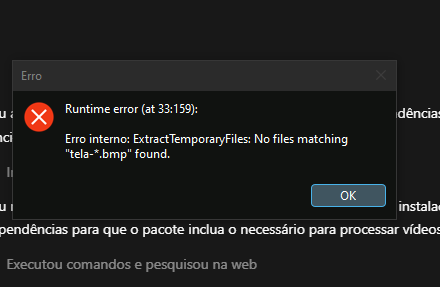
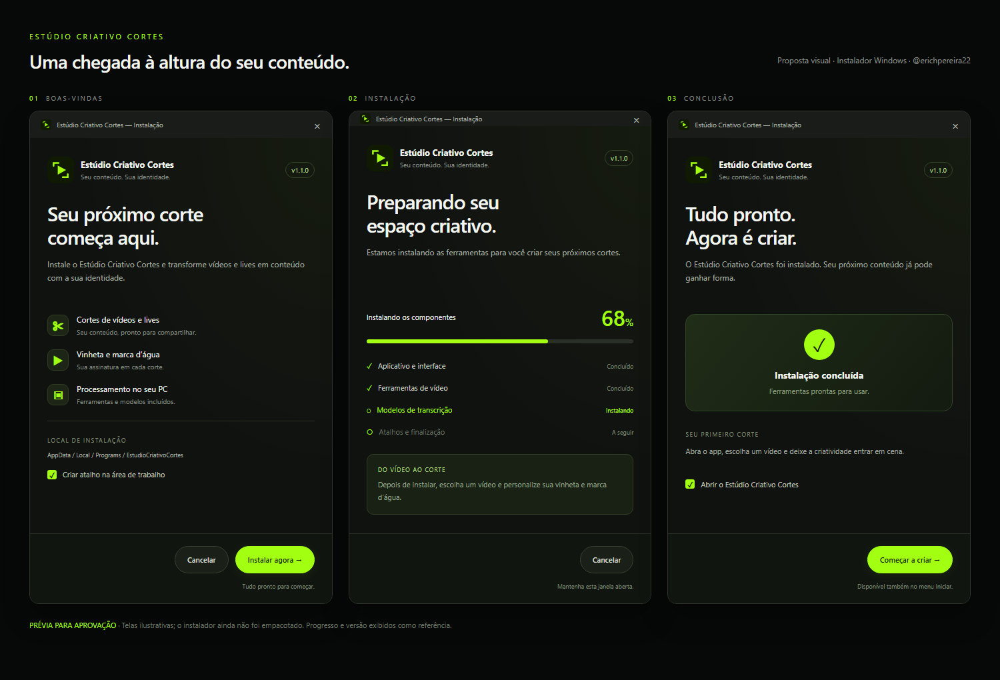

# Estúdio Criativo Cortes

**Cortes de vídeos e lives com processamento local, identidade visual e instalador completo para Windows.**

Edição personalizada mantida por **@erichpereira22**. A versão publicada atualmente é **v1.2.1**.



## O que o app faz

| Função | Como ajuda |
| --- | --- |
| Cortes de vídeo gravado | Importa um arquivo local ou baixa um vídeo por link para selecionar os melhores trechos. |
| Cortes ao vivo | Conecta a lives da Twitch, Kick e YouTube e permite recortar enquanto a transmissão acontece. |
| Transcrição local | Usa modelos do Whisper no computador para encontrar momentos e gerar legendas. |
| Editor de cortes | Ajusta início, fim, enquadramento, texto, legenda palavra por palavra e título antes da exportação. |
| Formatos de exportação | Gera versões verticais, originais, divididas ou com fundo, conforme o projeto. |
| Projetos e reedição | Guarda os cortes, metadados, legendas e a identidade usada para reabrir e editar depois. |
| Vinheta de 2 segundos | Coloca uma abertura ou encerramento em cada corte, com o áudio da vinheta quando existir. |
| Marca d’água | Aceita PNG, JPG e WebP e permite ajustar posição, tamanho, opacidade e margem. |
| Presets de identidade | Salva vinheta, logo e parâmetros com um nome para reutilizar em outros projetos. |
| Processamento local | Os vídeos e a transcrição são processados no computador, sem assinatura ou serviço Pro. |

## Instalar pelo `.exe` no Windows

Baixe o instalador na [release mais recente](https://github.com/erichpereira1996/estudio-criativo-cortes/releases/latest). O arquivo é **Instalar-Estudio-Criativo-Cortes.exe**.



1. Abra o arquivo baixado.
2. Na tela de boas-vindas, clique em **Instalar agora**.
3. Mantenha a opção de criar atalho na área de trabalho, se quiser.
4. Aguarde a cópia dos componentes e dos modelos de transcrição. A instalação pode levar alguns minutos e ocupa aproximadamente 1 GB.
5. Na tela final, clique em **Começar a criar** ou abra o app pelo menu Iniciar.

O instalador inclui Node.js, Python, FFmpeg, yt-dlp e os modelos base e small. Não é preciso instalar essas ferramentas separadamente. A instalação é feita apenas para o usuário atual e os arquivos de trabalho ficam na pasta de vídeos do usuário.

Vídeos locais podem ser processados sem internet depois da instalação. Links de vídeos, lives, downloads de ferramentas e modelos adicionais precisam de conexão.

### Primeira abertura

1. Abra **Estúdio Criativo Cortes** pelo atalho.
2. Escolha **Vídeo gravado** para usar um arquivo ou um link já disponível, ou **Ao vivo agora** para acompanhar uma transmissão.
3. Selecione o formato, o idioma e a qualidade desejada.
4. Aguarde a transcrição e revise os momentos encontrados.
5. Edite cada corte, confira a legenda e exporte.

## Identidade visual, vinheta e marca d’água

Abra **Identidade** no topo do app ou **Configurar identidade** na tela de geração.

- **Vinheta:** envie MP4, MOV ou WebM com pelo menos 2 segundos e escolha **No início do corte** ou **No fim do corte**.
- **Marca d’água:** envie PNG, JPG ou WebP e ajuste a posição pela grade, arrastando na prévia ou usando os controles.
- **Também na vinheta:** ativa a marca sobre a abertura ou encerramento.
- **Resetar identidade:** limpa as opções e anexos da configuração atual.
- **Presets:** informe um nome e clique em **Salvar como preset**. Para usar depois, selecione o preset, clique em **Carregar** e confirme com **Salvar identidade**.

A identidade começa limpa quando o app é aberto ou recarregado. Projetos já exportados conservam a identidade usada neles; excluir um preset não apaga os arquivos necessários para reeditá-los.

## Projetos, arquivos e dados

- Os cortes exportados ficam na pasta de dados escolhida no app, normalmente dentro de **Vídeos/Estúdio Criativo Cortes**.
- A configuração, os presets e os anexos da identidade ficam no perfil local do usuário.
- A desinstalação remove os arquivos do programa, mas preserva cortes, configurações, presets e anexos.
- Para liberar espaço, remova modelos ou arquivos baixados somente depois de confirmar que não serão usados em novos projetos.

## Atualizações e versões

A versão usa [Versionamento Semântico](https://semver.org/lang/pt-BR/) no formato `vMAJOR.MINOR.PATCH`.

- `PATCH`: correção compatível, como `v1.2.1` → `v1.1.2`.
- `MINOR`: nova função compatível, como `v1.2.1` → `v1.2.0`.
- `MAJOR`: mudança incompatível, como `v1.2.1` → `v2.0.0`.

O número mostrado no app, o instalador e o pacote vêm de `package.json`. O app verifica automaticamente a Release estável mais recente ao abrir, ao voltar para o foco e periodicamente. Se houver uma versão nova, ele baixa o instalador, fecha o programa, instala a atualização e abre novamente. As atualizações publicadas ficam na página de [Releases](https://github.com/erichpereira1996/estudio-criativo-cortes/releases). Baixe o instalador da versão desejada e execute-o sobre a instalação existente; seus cortes e presets são preservados.

## Usar o código-fonte

Para desenvolver sem o instalador:

1. Instale Node.js 20 ou superior, Python 3.12, FFmpeg, FFprobe e yt-dlp.
2. Clone o repositório:

   ```powershell
   git clone https://github.com/erichpereira1996/estudio-criativo-cortes.git
   cd estudio-criativo-cortes
   ```

3. Execute `instalar.bat` para preparar o ambiente de transcrição.
4. Execute `iniciar.bat` ou `npm start`.

Para validar as mudanças, configure `FFMPEG_PATH` e `FFPROBE_PATH` quando necessário e execute:

```powershell
npm test
```

## Compilar um novo instalador

Em um Windows x64 com Python 3.12 e Pillow instalado:

```powershell
python -m pip install Pillow==13.0.0
node instalador/montar.js
```

O script baixa ou reutiliza as ferramentas da pasta `instalador/cache`, monta uma instalação portátil, valida o Python embarcado, gera a arte do instalador e grava o resultado em:

```text
instalador/dist/Instalar-Estudio-Criativo-Cortes.exe
```

O workflow do GitHub Actions também pode gerar o instalador quando uma tag `v*` é publicada.

## Licença e origem

Esta é uma edição independente mantida por **@erichpereira22**. A origem do código e os avisos do projeto anterior estão em [THIRD_PARTY_NOTICES.md](THIRD_PARTY_NOTICES.md). O código permanece acompanhado da [licença MIT](LICENSE), e as licenças dos componentes de terceiros são mantidas nos avisos.
